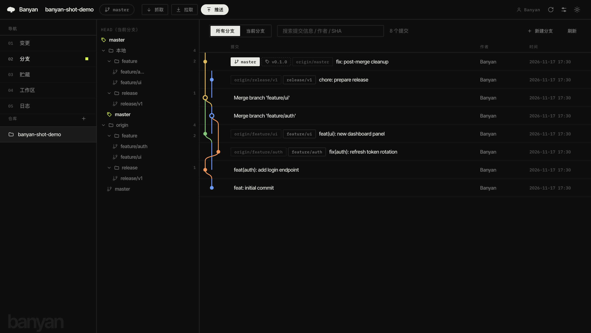
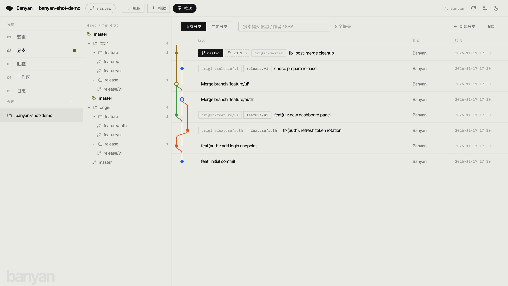

<div align="center">


# Banyan

**A local-first Git client with a modern, minimal UI.**

English | [简体中文](README.zh-CN.md)


</div>

> The interface is currently Simplified Chinese; an English UI is on the roadmap.

| Dark | Light |
| --- | --- |
|  |  |

## Why Banyan

Banyan (榕树) is named after the banyan tree: one trunk sends down prop roots that become new trunks — *one tree becomes a forest*, just like branches growing from a single repository. It aims to combine full-featured Git operations with a calm, editorial-grade interface, while keeping **everything on your machine**.

## Features

- **Changes** — stage / unstage / discard per file, side-by-side diff viewer, commit & amend, optional **AI commit messages** (any OpenAI-compatible endpoint).
- **Branches** — PyCharm-style branch tree (HEAD / local / remote groups, slash-prefix folders, ahead/behind badges) beside a **colored commit graph** with merge lanes and ref badges; click a branch to filter history.
- **Branch context menu** — checkout, new branch from…, checkout & rebase, checkout & update, compare (ahead/behind commits + full diff), diff against working tree, rebase current onto…, merge into current, new worktree from…, push, rename, delete.
- **Stash** — push (with untracked), pop / apply / drop.
- **Worktrees** — parallel working directories, add / remove.
- **Reflog** — every HEAD movement recorded, one-click undo (`reset --keep`, keeps uncommitted work).
- **Desktop app** — Tauri 2 native shell (WKWebView) with a bundled Node sidecar; unified title bar; `.dmg` bundle.
- **Themes** — dark / light, both tuned for readability.
- **Local-first & private** — server binds `127.0.0.1` only; all data lives in `~/.banyan`; no telemetry, no account.

## Install

Prebuilt releases are planned. For now, build from source (macOS 10.15+):

```bash
# 1. Prerequisites: Node.js >= 18 (tested on 23), Rust stable (tested on 1.100)
# 2. Place an official Node binary as the sidecar for your target:
#    desktop/src-tauri/binaries/node-aarch64-apple-darwin      (Apple Silicon)
#    desktop/src-tauri/binaries/node-x86_64-apple-darwin       (Intel)
#    desktop/src-tauri/binaries/node-x86_64-pc-windows-msvc.exe (Windows, planned)
cd desktop
npm install
npm run build        # → src-tauri/target/release/bundle/dmg/Banyan_<ver>_aarch64.dmg
```

> The sidecar binary (~100 MB) is intentionally **not** committed to this repository.
> In mainland China networks, `rsproxy.cn` is a reliable crates mirror if crates.io times out.

## Development (web mode)

The desktop shell and the browser share the same server and UI:

```bash
npm start            # node server.js → http://127.0.0.1:7788
```

Zero runtime dependencies — the backend uses only Node built-ins; the frontend is vanilla ES modules.

## Configuration

| Path | Purpose |
| --- | --- |
| `~/.banyan/repos.json` | registered repositories |
| `~/.banyan/settings.json` | theme, AI endpoint / key / model, log scope |

AI commit messages are optional: configure any OpenAI-compatible `POST /chat/completions` endpoint in Settings.

## Project structure

```
├── server.js                  # Node built-in http server + REST API
├── lib/                       # git operations / storage / AI commit messages
├── public/                    # vanilla ES-module frontend (css / js / fonts)
├── desktop/                   # Tauri 2 desktop shell
│   ├── src-tauri/             # Rust shell, capabilities, icons
│   ├── make_icon.py           # brand-mark rasterizer (same-source icon pipeline)
│   └── extract_silhouette.py  # photo → flat silhouette extraction
└── docs/                      # screenshots
```

## Roadmap

- [ ] Hunk-level staging
- [ ] GitButler-style virtual branches (multiple lanes in one working directory)
- [ ] Visual conflict editor
- [ ] History rewriting (squash, reorder, edit commit)
- [ ] PR creation / review integration
- [ ] English UI
- [ ] Windows & Linux packages, signed releases

## Contributing

Issues and pull requests are welcome. Please use [Conventional Commits](https://www.conventionalcommits.org/) (`feat(scope): …`, `fix(scope): …`) and keep the zero-runtime-dependency constraint.

## License

[MIT](LICENSE) © 2026 Jingxuan Zhou