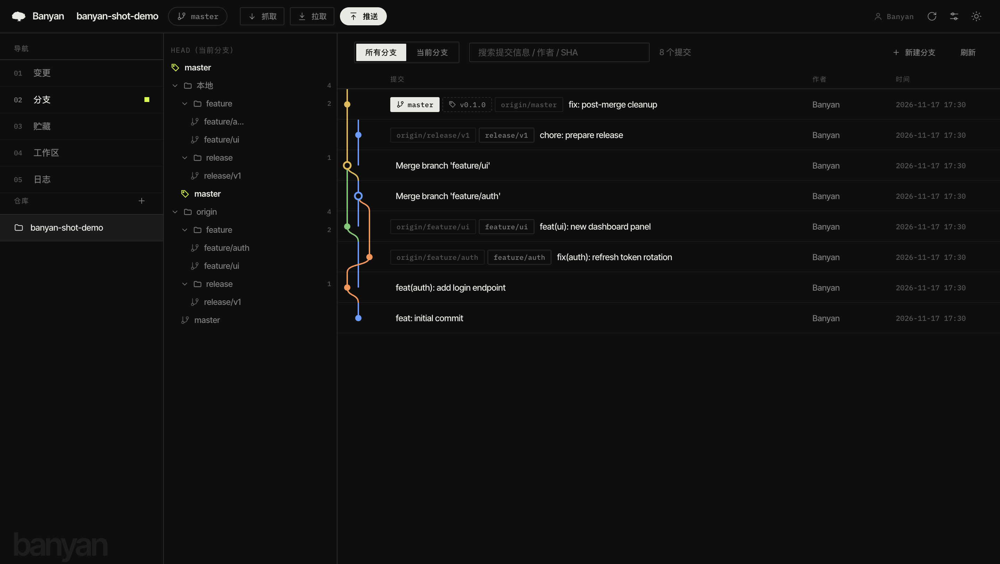
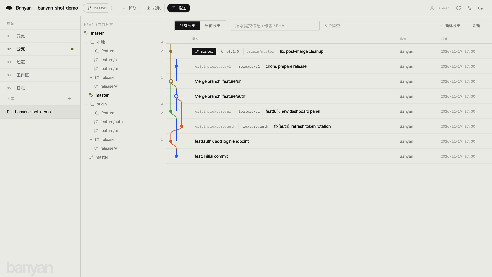

<div align="center">


# Banyan

**轻量、现代、本地优先的 Git 客户端。**

[English](README.md) | 简体中文


</div>

> 界面当前为简体中文，英文界面已列入路线图。

| 深色 | 浅色 |
| --- | --- |
|  |  |

## 为什么叫 Banyan

Banyan 即榕树：一根主干垂下气生根、落地成新干，「独木成林」——正如一个仓库派生出多条分支。Banyan 希望把完整的 Git 操作与克制、编辑级的界面结合起来，并且**一切数据只留在你的机器上**。

## 功能

- **变更**——按文件暂存 / 取消暂存 / 丢弃，差异查看器，提交与 amend，可选 **AI 提交信息**（任意 OpenAI 兼容接口）。
- **分支**——PyCharm 式分支树（HEAD / 本地 / 远程分组、斜杠前缀文件夹、ahead/behind 徽章）+ **彩色提交泳道图**（合并曲线、refs 徽章）；点击分支即过滤历史。
- **分支右键菜单**——签出、从…新建分支、签出并变基、签出并更新、比较（独有提交 + 完整 diff）、与工作树差异、将当前变基到…、合并到当前、从…新建工作树、推送、重命名、删除。
- **贮藏**——push（含未跟踪）、pop / apply / drop。
- **工作区**——并行工作目录（worktree）增删。
- **操作日志**——记录每次 HEAD 移动，一键回退（`reset --keep`，保留未提交修改）。
- **桌面应用**——Tauri 2 原生壳（WKWebView）+ 内置 Node sidecar；一体化标题栏；产出 `.dmg`。
- **主题**——深色 / 浅色，双主题均做过可读性调校。
- **本地优先与隐私**——服务仅监听 `127.0.0.1`；数据存于 `~/.banyan`；无遥测、无账号。

## 安装

预编译 Release 规划中。当前请从源码构建（macOS 10.15+）：

```bash
# 1. 前置：Node.js >= 18（实测 23）、Rust stable（实测 1.100）
# 2. 拉取桌面壳所需的官方 Node sidecar 二进制：
bash scripts/fetch-sidecar.sh          # 放置 desktop/src-tauri/binaries/node-<target-triple>
cd desktop
npm install
npm run build        # → src-tauri/target/release/bundle/dmg/Banyan_<ver>_aarch64.dmg
```

> sidecar 二进制（约 100 MB）**不入库**（超 GitHub 单文件限制）。
> 大陆网络若 crates.io 超时，可使用 `rsproxy.cn` 镜像。

### macOS Gatekeeper 说明

构建为 **ad-hoc 签名、未公证**（尚未配置 Apple Developer ID）。若 macOS 提示「已损坏」或「无法验证开发者」——常见于下载或经聊天工具传输后（会被附加隔离属性）——清除隔离属性后再打开：

```bash
xattr -cr /Applications/Banyan.app
```

Developer ID 签名与公证的 Release 已列入路线图。

### 每次更新后重复弹 macOS 隐私授权

macOS 将文件夹访问授权（桌面 / 文稿 / 下载）绑定到应用签名指纹。ad-hoc 签名每次构建都变化，因此每个新版本都会就仓库所在文件夹询问一次授权——这是预期行为而非死循环：每个版本允许一次即可。自签名稳定身份或公证的 Developer ID 包可消除重复询问（路线图）。

## 文档

- [CHANGELOG.md](CHANGELOG.md) — 版本历史
- [docs/ARCHITECTURE.md](docs/ARCHITECTURE.md) — 分层、sidecar 生命周期、提交图算法、签名
- [CONTRIBUTING.md](CONTRIBUTING.md) — 贡献指南

## 开发（Web 模式）

桌面壳与浏览器共用同一套服务与界面：

```bash
npm start            # node server.js → http://127.0.0.1:7788
```

零运行时依赖——后端仅用 Node 内置模块，前端为原生 ES modules。

## 配置

| 路径 | 用途 |
| --- | --- |
| `~/.banyan/repos.json` | 已注册仓库 |
| `~/.banyan/settings.json` | 主题、AI 接口 / Key / 模型、日志范围 |

AI 提交信息为可选功能：在设置中填写任意 OpenAI 兼容 `POST /chat/completions` 接口。

## 项目结构

```
├── server.js                  # Node 内置 http 服务 + REST API
├── lib/                       # git 操作 / 存储 / AI 提交信息
├── public/                    # 原生 ES modules 前端（css / js / fonts）
├── desktop/                   # Tauri 2 桌面壳
│   ├── src-tauri/             # Rust 壳、capabilities、图标
│   ├── make_icon.py           # 品牌标志光栅化（同源图标管线）
│   └── extract_silhouette.py  # 照片 → 扁平剪影提取
└── docs/                      # 截图
```

## 路线图

- [ ] hunk 级暂存
- [ ] GitButler 式虚拟分支（同一工作目录多条 lane）
- [ ] 可视化冲突编辑器
- [ ] 历史改写（squash、重排、改提交）
- [ ] PR 创建 / 审查集成
- [ ] 英文界面
- [ ] Windows / Linux 包与签名 Release

## 贡献

欢迎 Issue 与 PR。请使用 [Conventional Commits](https://www.conventionalcommits.org/)（`feat(scope): …`、`fix(scope): …`），并保持零运行时依赖约束。

## 许可

[MIT](LICENSE) © 2026 Jingxuan Zhou